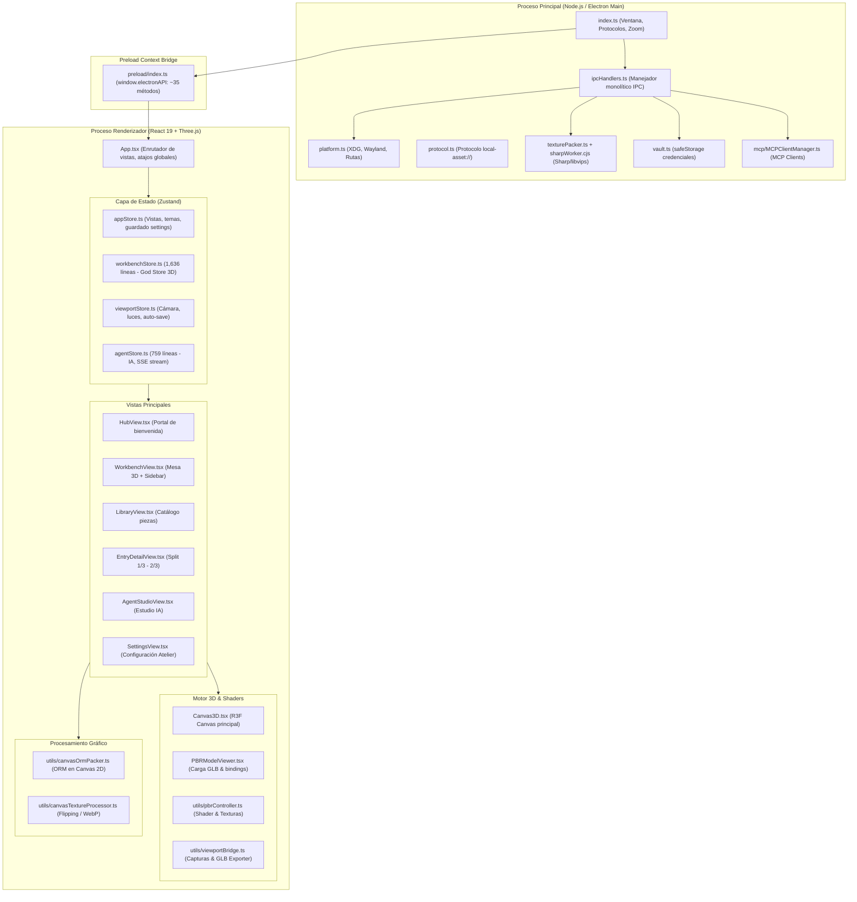

# Auditoría Arquitectónica & Plan de Modernización: Mirage 3D Workbench (Sera Atelier)

> **Fecha de Auditoría:** Septiembre 2026  
> **Ámbito:** Toda la base de código (`src/main`, `src/preload`, `src/renderer`, `resources`)  
> **Estado General:** Funcional y tipado (`tsc --noEmit` pasa sin errores), pero con **alta deuda técnica, acumulación de código monolítico (god-stores y god-components), doble implementación de subsistemas, carreras de datos en disco y cuellos de botella severos en Three.js**.

---

## 1. Mapa Arquitectónico del Sistema ("¿Qué hay y dónde está?")

El proyecto es una aplicación de escritorio basada en **Electron 34 + Vite + React 19 + TypeScript + Three.js / React Three Fiber + Tailwind CSS v4 + Zustand**.



### Inventario de Componentes y Módulos

| Módulo / Directorio | Archivos Clave | Responsabilidad | Diagnóstico Arquitectónico |
| :--- | :--- | :--- | :--- |
| **Electron Main** (`src/main/`) | [`index.ts`](file:///home/rei/Work/mirage-sera/src/main/index.ts), [`ipcHandlers.ts`](file:///home/rei/Work/mirage-sera/src/main/ipcHandlers.ts), [`platform.ts`](file:///home/rei/Work/mirage-sera/src/main/platform.ts), [`vault.ts`](file:///home/rei/Work/mirage-sera/src/main/vault.ts), [`protocol.ts`](file:///home/rei/Work/mirage-sera/src/main/protocol.ts) | Ciclo de vida nativo, protocolo `local-asset://`, almacenamiento seguro y puente con el SO. | **Monolítico**: `ipcHandlers.ts` (548 líneas) mezcla I/O de archivos, parseo de glTF en crudo, llamadas HTTP de IA y gestión de carpetas. Rutas de almacenamiento fragmentadas entre `~/.config` y `~/.local/share`. |
| **Preload Bridge** (`src/preload/`) | [`index.ts`](file:///home/rei/Work/mirage-sera/src/preload/index.ts), [`index.d.ts`](file:///home/rei/Work/mirage-sera/src/preload/index.d.ts) | Exposición tipada de APIs hacia `window.electronAPI`. | Superficie de API excesiva (35 métodos), sin validación ni confinamiento de rutas en métodos de escritura y eliminación de archivos. |
| **Stores Zustand** (`src/renderer/src/store/`) | [`workbenchStore.ts`](file:///home/rei/Work/mirage-sera/src/renderer/src/store/workbenchStore.ts), [`appStore.ts`](file:///home/rei/Work/mirage-sera/src/renderer/src/store/appStore.ts), [`viewportStore.ts`](file:///home/rei/Work/mirage-sera/src/renderer/src/store/viewportStore.ts), [`agentStore.ts`](file:///home/rei/Work/mirage-sera/src/renderer/src/store/agentStore.ts) | Estado global de la aplicación. | **Grave deuda técnica**: `workbenchStore.ts` tiene **1,636 líneas**; coexisten 3 modelos incompatibles de variantes; `appStore` y `viewportStore` guardan el mismo archivo compitiendo entre sí. |
| **Visor 3D & Three.js** (`src/renderer/src/components/Viewport/`, `utils/`) | [`Canvas3D.tsx`](file:///home/rei/Work/mirage-sera/src/renderer/src/components/Viewport/Canvas3D.tsx), [`PBRModelViewer.tsx`](file:///home/rei/Work/mirage-sera/src/renderer/src/components/Viewport/PBRModelViewer.tsx), [`pbrController.ts`](file:///home/rei/Work/mirage-sera/src/renderer/src/utils/pbrController.ts) | Renderizado PBR en tiempo real, manipulación de `MeshPhysicalMaterial` y shaders. | **Cuello de botella de rendimiento**: se fuerza recompilación de shaders (`needsUpdate = true`) en cada movimiento de slider; `AgentStudioView` monta un **segundo Canvas WebGL concurrente**. |
| **Staging & Mapas** (`src/renderer/src/components/Staging/`) | [`MapSlotPicker.tsx`](file:///home/rei/Work/mirage-sera/src/renderer/src/components/Staging/MapSlotPicker.tsx), [`PbrMapsStudio.tsx`](file:///home/rei/Work/mirage-sera/src/renderer/src/components/Staging/PbrMapsStudio.tsx), [`OrmPackerModal.tsx`](file:///home/rei/Work/mirage-sera/src/renderer/src/components/Staging/OrmPackerModal.tsx) | Asignación de mapas de textura, conversión WebP, empaquetado ORM. | `MapSlotPicker.tsx` tiene **804 líneas**. Coexisten 2 motores de empaquetado ORM (Sharp en Node vs Canvas 2D en navegador) con lógica redundante. |
| **Biblioteca & Detalle** (`src/renderer/src/components/Library/`) | [`LibraryView.tsx`](file:///home/rei/Work/mirage-sera/src/renderer/src/components/Library/LibraryView.tsx), [`EntryDetailView.tsx`](file:///home/rei/Work/mirage-sera/src/renderer/src/components/Library/EntryDetailView.tsx), [`SaveToLibraryModal.tsx`](file:///home/rei/Work/mirage-sera/src/renderer/src/components/Library/SaveToLibraryModal.tsx) | Gestión de piezas, navegación 1/3 - 2/3 y variantes de acabado. | `EntryDetailView.tsx` (**714 líneas**) maneja estado local divergente del estado del workbench y duplica lógica de persistencia. |
| **Estudio IA** (`src/renderer/src/components/Agent/`) | [`AgentStudioView.tsx`](file:///home/rei/Work/mirage-sera/src/renderer/src/components/Agent/AgentStudioView.tsx), [`EmbeddedViewport.tsx`](file:///home/rei/Work/mirage-sera/src/renderer/src/components/Agent/EmbeddedViewport.tsx), `ActionCard.tsx` | Asistente conversacional, ejecución de herramientas y razonamiento técnico. | Ruptura total del Design System (`rounded-lg`, `rounded-full`, `rounded-2xl`). Manejo de SSE y parsing de tokens de razonamiento incrustado directamente en el store. |
| **Exportación & Auditoría** (`src/renderer/src/components/Export/`, `Audit/`) | [`ExportStudio.tsx`](file:///home/rei/Work/mirage-sera/src/renderer/src/components/Export/ExportStudio.tsx), [`PerformanceAudit.tsx`](file:///home/rei/Work/mirage-sera/src/renderer/src/components/Audit/PerformanceAudit.tsx) | Exportación a GLB standalone, generación de paquetes ZIP web y miniatura WebP. | `ExportStudio.tsx` (**685 líneas**) mezcla auditoría de polígonos, herramientas de imagen, captura de canvas y generación de ZIP. |

---

## 2. Hallazgos Críticos: Anti-Patrones, Bugs y Deuda Técnica

### 🔴 1. Cuello de botella en Three.js: Recompilación de Shaders en cada arrastre de Slider
- **Ubicación:** [`src/renderer/src/utils/pbrController.ts#L531-L534`](file:///home/rei/Work/mirage-sera/src/renderer/src/utils/pbrController.ts#L531-L534)
- **Problema:** En la función `applyPbrState`, al final del recorrido del árbol de mallas, se ejecuta:
  ```typescript
  meshCount++;
  mat.needsUpdate = true; // <-- ERROR DE RENDIMIENTO SEVERO
  ```
- **Impacto:** En Three.js, alterar un uniform (`roughness`, `metalness`, `normalScale`, `aoMapIntensity`) **no requiere** `mat.needsUpdate = true`. Marcar `needsUpdate = true` fuerza a Three.js a recompilar el programa de sombreadores GLSL y reasociar búferes de GPU. Al arrastrar un slider interactivo (60 eventos por segundo), la aplicación se congela y pierde frames.
- **Solución:** Solo marcar `needsUpdate = true` si cambia la presencia de una textura (`null` $\leftrightarrow$ `Texture`), o si cambia el espacio de color o el canal de depuración (`debugChannel`).

### 🔴 2. Dos Contextos WebGL Concurrentes & Duplicación de Carga de Modelos
- **Ubicación:** [`src/renderer/src/App.tsx#L75-L85`](file:///home/rei/Work/mirage-sera/src/renderer/src/App.tsx#L75-L85) y [`src/renderer/src/components/Agent/EmbeddedViewport.tsx#L28-L45`](file:///home/rei/Work/mirage-sera/src/renderer/src/components/Agent/EmbeddedViewport.tsx#L28-L45)
- **Problema:** Para preservar el estado 3D, el Canvas principal de `WorkbenchView` se mantiene permanentemente en el DOM con `visibility: hidden`. Cuando el usuario abre la pestaña `Estudio IA`, `EmbeddedViewport` monta un **segundo componente `<Canvas>` de Three.js**, que vuelve a cargar el GLB, duplica la memoria VRAM y ejecuta listeners reactivos en paralelo.
- **Impacto:** Fugas potenciales de memoria WebGL en Linux/Wayland, consumo duplicado de VRAM y llamadas conflictivas a `setModelStats`.
- **Solución:** Compartir el mismo viewport desacoplando el contenedor del Canvas principal, o renderizar un snapshot offscreen interactivo (o render target con menor resolución) en lugar de una instancia R3F completa duplicada.

### 🔴 3. Carrera de Datos (Race Condition) en `settings.json` y Almacenamiento Fragmentado
- **Ubicación:** [`src/renderer/src/store/appStore.ts#L120-L135`](file:///home/rei/Work/mirage-sera/src/renderer/src/store/appStore.ts#L120-L135) y [`src/renderer/src/store/viewportStore.ts#L120-L135`](file:///home/rei/Work/mirage-sera/src/renderer/src/store/viewportStore.ts#L120-L135)
- **Problema:** Tanto `appStore` como `viewportStore` implementan un guardado diferido independiente (`setTimeout` de 400ms) que hace `loadSettings()` seguido de `saveSettings()`. Si el usuario modifica ajustes de viewport y de tema simultáneamente, un store sobreescribe los cambios del otro.
- **Fragmentación física:**
  - `~/.local/share/mirage`: `settings.json`, `keybinds.json`, `library/`
  - `~/.config/mirage`: `sera_vault.enc`, `mcp_config.json`
  - `localStorage`: proveedores IA, historial de sesiones, estado de sidebars
- **Solución:** Unificar la persistencia en una única capa centralizada en el proceso principal con debounce atómico y consolidar todos los datos bajo `getMirageDataDir()`.

### 🔴 4. El "God Store": `workbenchStore.ts` (1,636 líneas) y el triple modelo de variantes
- **Ubicación:** [`src/renderer/src/store/workbenchStore.ts`](file:///home/rei/Work/mirage-sera/src/renderer/src/store/workbenchStore.ts)
- **Problema:** `workbenchStore` concentra todo el modelo de datos de Mirage:
  1. Coexisten 3 estructuras simultáneas: `variants: EntryVariant[]`, `mapVariants: Record<SlotName, MapVariantItem[]>`, y `colorways: ColorwayItem[]`. Cada acción ejecuta bucles de mapeo manual para intentar sincronizarlas.
  2. Contiene 14 setters de sliders que repiten exactamente la misma lógica de clonación inmutable.
  3. Contiene la función `generateExportConfig()` de 75 líneas, acoplando la lógica de exportación web directamente al store.
- **Solución:** Dividir en sub-stores modulares (`useModelStore`, `usePbrMaterialStore`, `useVariantStore`, `useExportStore`) con un modelo canónico único donde las variantes de pieza son la única fuente de verdad (`EntryVariant[]`).

### 🟡 5. Fuga de Teclado en `CommandManager` (Captura indebida de `Ctrl+Z`)
- **Ubicación:** [`src/renderer/src/agent/commandManager.ts#L115-L130`](file:///home/rei/Work/mirage-sera/src/renderer/src/agent/commandManager.ts#L115-L130)
- **Problema:** El constructor de `CommandManager` escucha eventos globales de teclado (`window.addEventListener('keydown')`) sin verificar si el elemento activo es un `<input>`, `<textarea>` o elemento editable.
- **Impacto:** Si un usuario está escribiendo un mensaje en el chat del agente o renombrando una pieza y presiona `Ctrl+Z`, la acción deshace una modificación del modelo 3D en lugar de deshacer el texto escrito.
- **Solución:** Agregar la guarda `if (e.target instanceof HTMLInputElement || e.target instanceof HTMLTextAreaElement || e.target.isContentEditable) return;`.

### 🟡 6. Bug de Reactividad en `App.tsx` con `selectedEntryForDetail`
- **Ubicación:** [`src/renderer/src/App.tsx#L104-L107`](file:///home/rei/Work/mirage-sera/src/renderer/src/App.tsx#L104-L107)
- **Problema:**
  ```tsx
  <EntryDetailView
    entry={useAppStore.getState().selectedEntryForDetail}
    onBack={() => useAppStore.getState().setView('library')}
  />
  ```
  `App.tsx` lee `selectedEntryForDetail` de forma imperativa mediante `useAppStore.getState()`. Al no suscribirse al selector en el cuerpo del hook (`useAppStore((s) => s.selectedEntryForDetail)`), si la pieza seleccionada se actualiza mientras la vista está abierta, `App.tsx` no se re-renderiza.
- **Solución:** Suscribir el componente a la propiedad del store.

### 🟡 7. Duplicación de Código en Redimensionado de Sidebars
- **Ubicación:** [`src/renderer/src/components/Workbench/WorkbenchView.tsx#L31-L72`](file:///home/rei/Work/mirage-sera/src/renderer/src/components/Workbench/WorkbenchView.tsx#L31-L72)
- **Problema:** En `src/renderer/src/hooks/useResizableSidebar.ts` existe un hook reutilizable diseñado específicamente para sidebars redimensionables con memoria `localStorage`. Sin embargo, `WorkbenchView.tsx` re-implementa toda la lógica matemática de arrastre con event listeners manuales.
- **Solución:** Reemplazar el bloque manual en `WorkbenchView.tsx` por el hook `useResizableSidebar`.

### 🟡 8. Violaciones del Sistema de Diseño Sera Atelier (`DESIGN.md`)
- **Ubicación:** Componentes en [`src/renderer/src/components/Agent/`](file:///home/rei/Work/mirage-sera/src/renderer/src/components/Agent/)
- **Problema:** [`DESIGN.md`](file:///home/rei/Work/mirage-sera/DESIGN.md) prohíbe explícitamente radios de borde redondeados decorativos (`radius-default: 0px`, `radius-subtle: 2px`). En `AgentStudioView.tsx`, `ActionCard.tsx`, `UserMessageBubble.tsx` y `StudioRightSidebar.tsx` abundan clases como `rounded-lg`, `rounded-xl`, `rounded-2xl` y `rounded-full`.
- **Solución:** Homogeneizar los estilos a tokens `rounded-xs` (2px) o bordes arquitectónicos rectos de 1px (`border-hairline`).

### 🟡 9. Doble Motor de Empaquetado ORM y Procesamiento de Texturas
- **Ubicación:** [`src/main/texturePacker.ts`](file:///home/rei/Work/mirage-sera/src/main/texturePacker.ts) vs [`src/renderer/src/utils/canvasOrmPacker.ts`](file:///home/rei/Work/mirage-sera/src/renderer/src/utils/canvasOrmPacker.ts)
- **Problema:** La aplicación mantiene dos motores completos para la misma tarea: un subproceso en Node con Sharp y un manipulador en Canvas 2D en el navegador. `OrmPackerModal.tsx` intenta Canvas y recurre a Sharp como fallback. Mantener ambos duplica dependencias y puntos de fallo.
- **Solución:** Estandarizar en el motor principal basado en Canvas (que aprovecha la GPU del navegador y no tiene conflictos de dependencias nativas C++ de Sharp en Linux) o formalizar el worker de Sharp como servicio aislado bien documentado.

### ⚪ 10. Ausencia Total de Pruebas Automatizadas
- **Ubicación:** Repositorio completo (0 archivos de prueba).
- **Problema:** No existe infraestructura de pruebas (ni Vitest ni Jest ni Playwright). Modificaciones en la lógica de cálculo de bounding box, packing de canales o sincronización de variantes no tienen ninguna red de seguridad.

---

## 3. Arquitectura Objetivo Propuesta (Target Architecture)

```
src/
├── main/
│   ├── index.ts                   # Entrada y ciclo de vida de la ventana
│   ├── protocol.ts                # Protocolo local-asset:// (optimizado)
│   ├── platform.ts                # Detección de SO y rutas canónicas consolidadas
│   ├── services/                  # Lógica de negocio del proceso principal desacoplada
│   │   ├── libraryService.ts      # Lectura/escritura/eliminación segura en disco
│   │   ├── settingsService.ts     # Persistencia atómica de configuración
│   │   ├── vaultService.ts        # Credenciales seguras (safeStorage)
│   │   ├── mcpService.ts          # Integración cliente MCP
│   │   └── textureService.ts      # Worker opcional de procesamiento pesado
│   └── ipc/
│       ├── libraryIpc.ts          # Canales IPC de biblioteca
│       ├── settingsIpc.ts         # Canales IPC de ajustes
│       ├── mcpIpc.ts              # Canales IPC de MCP
│       └── dialogsIpc.ts          # Diálogos de guardado/apertura nativos
│
├── preload/
│   ├── index.ts                   # Exposición segura mediante contextBridge
│   └── index.d.ts                 # Contratos TypeScript estrictos
│
└── renderer/
    └── src/
        ├── App.tsx                # Enrutador limpio y suscripciones correctas
        ├── store/                 # Sub-stores modulares en Zustand
        │   ├── appStore.ts        # Vistas activas, estado global de UI
        │   ├── modelStore.ts      # Archivo GLB, estadísticas y metrología
        │   ├── pbrMaterialStore.ts# Sliders PBR y canales de depuración
        │   ├── variantStore.ts    # Perfiles y variantes de acabado (1 a N)
        │   ├── viewportStore.ts   # Cámara, luces y entornos HDR
        │   └── agentStore.ts      # Historial y sesiones de IA
        ├── services/              # Clientes de API y streaming
        │   ├── aiStreamService.ts # Cliente SSE y parseo de tokens
        │   └── libraryBridge.ts   # Auto-guardado y puente con el disco
        ├── components/            # Componentes segmentados (<250 líneas c/u)
        │   ├── Navigation/
        │   ├── Viewport/          # Visor R3F optimizado sin recompilaciones innecesarias
        │   ├── Staging/           # Gestión de mapas PBR y variantes
        │   ├── Library/           # Catálogo y detalle de piezas
        │   ├── Agent/             # Estudio IA alineado al Design System Sera
        │   ├── Export/            # Generación de GLB, ZIP y posters
        │   └── UI/                # Primitivas con tokens estrictos (0px / 2px)
        └── utils/
            ├── pbrController.ts   # Enlace de materiales Three.js de alto rendimiento
            ├── keybindsManager.ts # Atajos con filtrado estricto de inputs
            └── glbValidator.ts    # Análisis geométrico
```

---

## 4. Hoja de Ruta de Refactorización (Step-by-Step Roadmap)

### Fase 1: Estabilización de Rendimiento y Corrección de Bugs Inmediatos (Prioridad Alta)
1. **Corregir recompilación de sombreadores en Three.js:**
   - En [`pbrController.ts`](file:///home/rei/Work/mirage-sera/src/renderer/src/utils/pbrController.ts), eliminar `mat.needsUpdate = true` incondicional en el bucle de actualización.
   - Activar `mat.needsUpdate` únicamente cuando se modifiquen enlaces de texturas o mapas auxiliares.
2. **Corregir captura indebida de teclado en `CommandManager`:**
   - En [`commandManager.ts`](file:///home/rei/Work/mirage-sera/src/renderer/src/agent/commandManager.ts), ignorar eventos `keydown` cuando el foco esté en elementos interactivos de texto.
3. **Resolver la suscripción reactiva en `App.tsx`:**
   - Suscribir `selectedEntryForDetail` mediante selector reactivo.
4. **Desactivar el segundo Canvas concurrente en `AgentStudioView`:**
   - Suspender o re-enrutar el renderizado de `Canvas3D` cuando se navega al Estudio IA para evitar dos instancias activas de WebGL.

### Fase 2: Saneamiento del Estado y Persistencia (Prioridad Alta)
1. **Unificar la persistencia de configuración:**
   - Fusionar el guardado de `appStore` y `viewportStore` en un único servicio IPC atómico en el proceso principal.
   - Consolidar `sera_vault.enc` y `mcp_config.json` dentro de `getMirageDataDir()` para que toda la información resida en una única carpeta canónica.
2. **Modularizar el "God Store" (`workbenchStore.ts`):**
   - Extraer la lógica de exportación web (`generateExportConfig`) a una función de utilidad en `utils/exportConfigGenerator.ts`.
   - Crear un setter genérico para los parámetros de material que elimine las 14 funciones duplicadas.
   - Consolidar `variants`, `mapVariants` y `colorways` en el modelo unificado de `EntryVariant[]`.

### Fase 3: Modularización de Componentes Monolíticos (Prioridad Media)
1. **Descomponer `MapSlotPicker.tsx` (804 líneas):**
   - Extraer `MapVariantRowItem.tsx`, `MapSlotHeader.tsx` y los generadores de nombres técnicos a archivos separados.
2. **Descomponer `EntryDetailView.tsx` (714 líneas):**
   - Extraer `TechnicalSheetSection.tsx` (1/3 izquierdo) y `VariantManagerGrid.tsx` (2/3 derecho).
3. **Descomponer `ExportStudio.tsx` (685 líneas):**
   - Separar en `PosterCapturePanel.tsx`, `GlbExportPanel.tsx`, `ZipExportPanel.tsx` y `TextureProcessorPanel.tsx`.
4. **Adopción de `useResizableSidebar` en `WorkbenchView.tsx`:**
   - Eliminar el cálculo manual de 45 líneas y utilizar el hook ya existente.

### Fase 4: Alineación del Design System & Pruebas Automatizadas (Prioridad Media-Baja)
1. **Homogeneización visual en `AgentStudioView`:**
   - Reemplazar todas las clases `rounded-lg`, `rounded-xl`, `rounded-full` por `rounded-xs` y bordes `border-hairline`.
2. **Configuración de Vitest:**
   - Instalar `vitest` e implementar pruebas unitarias para:
     - `glbValidator.ts` (conteo de polígonos y auditoría de escalas).
     - `pathUtils.ts` (normalización de URLs de protocolo).
     - `libraryBridge.ts` (cálculo de hashes y preservación de variantes).
     - `commandManager.ts` (ejecución y reversión de transacciones).
